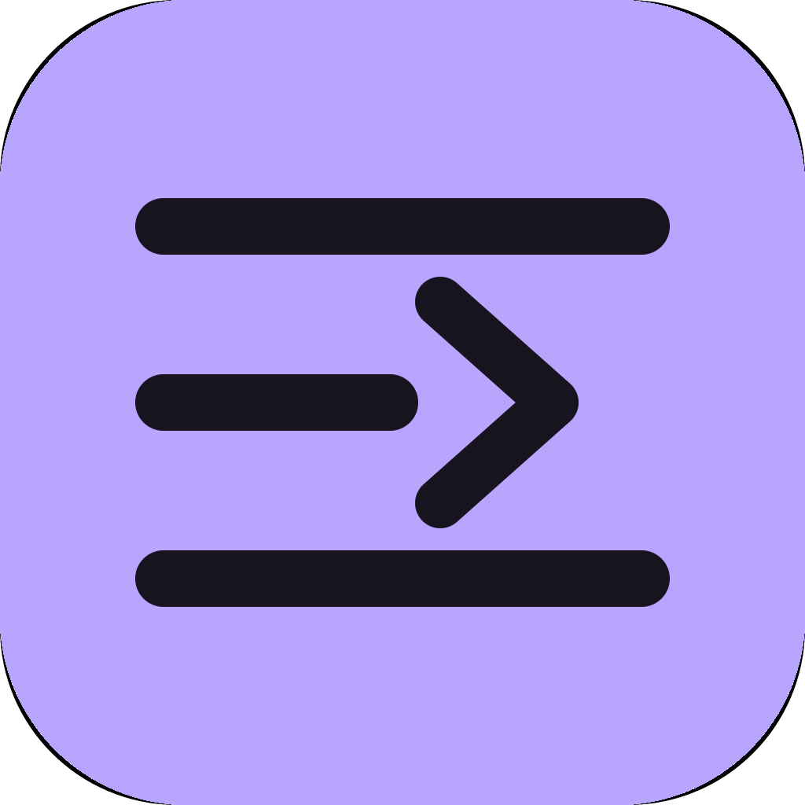

# Cutmark



Cutmark is a local browser-based video editor for precise trims, joined ranges, named clips and small multi-source assemblies. Correct captions, reframe footage, adjust audio, add titles/logos, and export a reviewed MP4.

**Try it live:** [cutmark.dev](https://cutmark.dev)

 

## Features

- Import MP4, MOV, WebM, and MKV videos.
- Set an exact trim range by dragging the timeline or entering timecodes.
- Review decoded source thumbnails and audio peaks, zoom the timeline, and navigate long footage.
- Preview and loop a selection, review cut context, step decoded frames, and change preview speed/volume.
- Keep, split, remove and reorder source sections with exact video/sample timing.
- Export named clips sequentially with independent captured formats and safe cancellation.
- Assemble up to four local sources, including mixed dimensions/frame rates and missing-media relinking.
- Reframe landscape, square and portrait versions with fit/fill, drag/scale, rotation/flips and preview-only guides.
- Adjust exported gain/mute/fades separately from listening volume; review measured pause suggestions.
- Add timed titles/lower thirds and transparent local image/logo layers.
- Capture source/composed PNGs and download a timecoded edit report.
- Scan source or selected footage with recorded coverage, sensitivity and frame refinement; confirm, move or dismiss scene candidates safely.
- Add searchable named source markers with color and notes, independent of scene detection.
- Independently transcribe English captions for the selection or full source.
- Correct, search, split, merge, shift and replace captions with undo and readability guidance.
- Import/export reviewed SRT/VTT, style captions, and choose actual burned-in MP4 captions or subtitle files.
- Save portable project files/source-inclusive bundles and reusable output/naming presets.
- Autosave unfinished projects and reopen them in the current browser.
- Undo and redo range, caption, marker, framing, audio, title/image and assembly decisions.
- Inspect actual source frames, enter hour timecodes, and cancel processing safely.
- Keep previous exports downloadable while revising or retrying.
- Keep video processing on the device; source clips are not uploaded to an application server.

## Technologies

- Next.js, React, TypeScript, and Tailwind CSS
- WebCodecs for browser video encoding when supported
- FFmpeg WebAssembly as a video processing fallback
- Transformers.js and Whisper Tiny English for speech transcription
- IndexedDB for recent project history
- AWS CDK, Amazon S3, and Amazon CloudFront for hosting

## The Process

I built Cutmark as a static Next.js app so the editor can run without a video-processing backend. The browser uses WebCodecs when available and falls back to FFmpeg WebAssembly for trimming and encoding. Scene detection and speech transcription are optional steps, so the basic export workflow can stay lightweight.

Unfinished drafts and exports are stored separately in IndexedDB in the browser. Projects keep source media, editable captions, scene cuts, selections, and the last successful output. Projects remain until explicitly deleted; browser storage is not a backup. The source clip stays on the user's device; the English speech model is downloaded from Hugging Face the first time captions are generated. Caption corrections remain in source time across trims and exports. Recognition text is preserved for review rather than automatically deleting repeated words.

For deployment, the site is exported as static files and served from a private S3 bucket through CloudFront. GitHub Actions builds the frontend and deploys it when changes reach `main`.

## What I Learned

Building a video editor in the browser meant working around differences in codec support and available hardware. Using WebCodecs with an FFmpeg fallback gave the app another path when a browser cannot encode a particular video.

I also learned to treat video files as large local data: project history needs browser storage, and editing a saved project requires keeping its source clip as well as its export. Deploying a static Next.js app through S3 and CloudFront gave me a simple way to publish updates through GitHub Actions.

## Running the Project

```bash
git clone https://github.com/KrishTday/Cutmark.git
cd Cutmark/frontend
npm ci
npm run dev
```

Open [http://localhost:3000](http://localhost:3000) in your browser. To check the production build or run lint:

```bash
npm run build
npm run lint
```

Caption generation downloads the Whisper Tiny English model on first use. It transcribes English speech; browser codec support and local storage capacity vary by device.

## License

MIT. See [LICENSE](LICENSE).


## Implementation verification and backlog

See the [Phase 1 safety checklist](docs/phase-1.md), [Phase 2 visual-editing checklist](docs/phase-2.md), [Phase 3 caption-delivery checklist](docs/phase-3.md), [Phase 3 export-settings checklist](docs/phase-3-export.md), the [Phase 3 recovery/storage checklist](docs/phase-3-recovery.md), [Phase 4 repurposing checklist](docs/phase-4.md), [Phase 5 workflow checklist](docs/phase-5.md), and [complete item-status matrix](docs/backlog.md) for implemented, verified and deferred work.

Frontend checks: `npm test`, `npm run lint`, and `npm run build`. Builds and development use Next.js Webpack because the default bundler emitted the processing workers as TypeScript assets rather than executable JavaScript.

The browser suite at `frontend/tests/browser.mjs` generates local fixtures with FFmpeg and exercises the production export in Edge. It requires Playwright, an installed Edge browser, FFmpeg/ffprobe on PATH, and a local static server. Set `CUTMARK_TEST_URL` to that server, `CUTMARK_PLAYWRIGHT_PATH` to an installed Playwright package if it is not available normally, and optionally `CUTMARK_ARTIFACTS` to a folder for fixtures, outputs, and screenshots; then run `node tests/browser.mjs` from `frontend`.

The Phase 2 suite at frontend/tests/phase2.mjs exercises decoded thumbnails/waveforms, native transport, source-based transcript operations and adaptive layout. It uses the Phase 1 fixture directory via CUTMARK_ARTIFACTS. The real-English speech suite also verifies cached recognition and full-source transcription before export.

The scene-tools suite at frontend/tests/scenes.mjs verifies recorded/refined scene analysis, preserved cut corrections, marker notes, interrupted scans and a long source-timed transcript follow/browse workflow. It reuses CUTMARK_ARTIFACTS from the other browser suites.

The caption-delivery suite at frontend/tests/caption-delivery.mjs verifies reviewed SRT/VTT import, persistent styles, actual burned-in MP4 captions, native/compatible paths, portrait wrapping and recovery after cancellation/font/overflow failures. It reuses CUTMARK_ARTIFACTS and requires FFmpeg/ffprobe. Export presets and actual resolution/quality/audio controls are now implemented; portable project backups/relinking, project titles/duplication and targeted cache management are now implemented in Phase 3C.

The export-settings suite at frontend/tests/export-settings.mjs measures native/compatible quality and file-size changes, output dimensions/audio, target-sized caption parity, preset undo/reopening and persisted measured output metadata. It uses the same test environment and writes artifacts under export-settings.

The project-backups and storage-tools suites verify fresh-profile portable recovery, exact-media relinking, shared-media duplication/deletion, version-2 migration, quota rollback, protected downloads and scoped model-cache cleanup. See docs/phase-3-recovery.md for the portable format and completed Phase 3 scope. The Phase 4/5 flows are now implemented; the item-status matrix separates completed core flows from conditional extensions and manual verification gaps.

The new suites are frontend/tests/sequences.mjs, assembly.mjs, framing.mjs, finishing.mjs, images.mjs and join-precision.mjs. They verify actual joins, continuous audio, framing/layer pixels, per-job recovery, multi-asset backups and 100 off-grid VFR ranges without accumulated drift. Build once before starting browser tests; replacing frontend/out while pages load hashed chunks invalidates a run. Exact composed/joined exports require a supported browser video encoder; compatible preparation adapts source codecs locally. See the current checklists for limits rather than assuming all 100 conditional backlog ideas or all browsers are supported.
